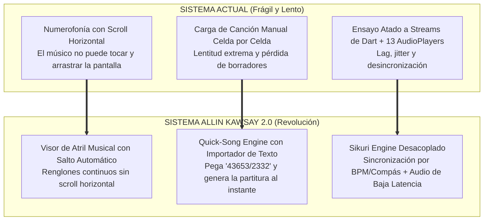
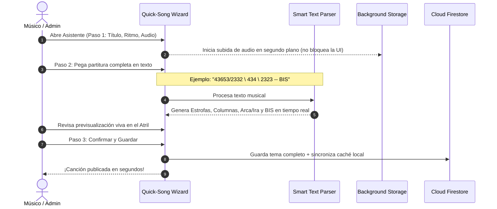
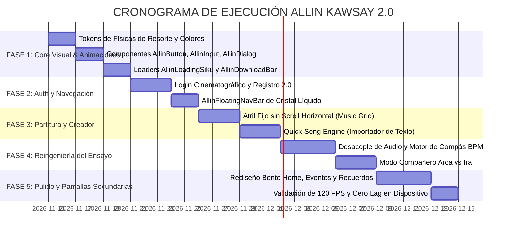

# 📜 MAQUETA MAESTRA INTEGRAL: AUDITORÍA Y REDISEÑO TOTAL ALLIN KAWSAY 2.0
**Conjunto de Integración Arte y Cultura (C.I.A.C.) Allin Kawsay · Juliaca, Puno, Perú**  
*Auditoría Exhaustiva de Código (130 archivos), Diagnóstico de Rendimiento, Arquitectura de Animaciones 120 FPS, Nuevo Visor de Atril Musical y Reingeniería del Motor de Ensayo.*

---

## 📑 ÍNDICE GENERAL
1. **Auditoría Técnica y Diagnóstico Archivo por Archivo (130 Archivos)**
   - 1.1. Core, Design System y Tokens (`lib/core/` y `lib/design/`)
   - 1.2. Módulo de Autenticación y Onboarding (`lib/features/auth/` y `lib/features/onboarding/`)
   - 1.3. Pantalla de Inicio y Bento Grid (`lib/features/inicio/` y `lib/features/home/`)
   - 1.4. Cancionero, Búsqueda y Detalle (`lib/features/cancionero/`, `lib/features/cancion_detalle/`, `lib/features/busqueda/`)
   - 1.5. El Subsistema de Ensayo, Grabación y Zampoña Virtual (`lib/features/ensayo/`, `lib/features/grabar/`, `lib/features/zampona/`)
   - 1.6. Eventos y Ubicación GPS (`lib/features/eventos/`)
   - 1.7. Galería de Recuerdos Multimedia (`lib/features/recuerdos/`)
   - 1.8. Panel de Administración y DevTools (`lib/features/admin/`)
   - 1.9. Perfil, Caché, Historia y Módulos Secundarios (`lib/features/perfil/`, `lib/features/historia/`, `lib/features/suscripcion/`, `lib/features/compartir/`, `lib/features/update/`)
   - 1.10. Capa de Modelos de Datos (`lib/models/`)
   - 1.11. Capa de Servicios y Backend Firebase (`lib/services/`)
   - 1.12. Widgets Compartidos y Diálogos (`lib/widgets/`)
2. **Los 3 Cuellos de Botella Críticos y su Solución Radical**
   - 2.1. El Visor de Numerofonía con Scroll Horizontal: Muerte a la partitura ilegible
   - 2.2. La Lentitud Extrema al Agregar Canciones: El cuello de botella de 300 campos
   - 2.3. La Saturación de Audio y el Falso "Lag de Dart": 13 AudioPlayers en paralelo y toques manuales
3. **El Nuevo Sistema de Partitura: "Atril Fijo con Salto de Sistema Automático"**
   - 3.1. Algoritmo de Reparto Musical (Responsive Music Grid)
   - 3.2. Formato Visual Andino de Doble Hilera (7 Arca / 6 Ira)
   - 3.3. Modo Pantalla Completa "Atril de Escenario" (Landscape No-Touch)
4. **El Asistente Rápido de Canciones: "Quick-Song Engine"**
   - 4.1. Importador Inteligente por Notación Textual Rápida
   - 4.2. Wizard Compacto en 3 Fases con Autoguardado Local Reactivo
   - 4.3. Pipeline Asíncrono de Subida de Medios en Background
5. **Arquitectura Visual 2.0: "Dark Luxury Neo-Andino" & Animaciones a 120 FPS**
   - 5.1. Paleta Cromática y Tokens de Superficie (OLED + Oro Solar + Granate)
   - 5.2. Motor de Físicas de Resorte (*Spring Simulations*)
   - 5.3. Catálogo de Animaciones Maestras (Shimmer, Liquid Capsule Nav Bar, Siku Loader, Liquid Progress Bar, Modales 3D)
6. **Reingeniería del Motor de Ensayo: "Sikuri Engine" (Flutter + Rust / Oboe Core)**
   - 6.1. Modo Compañero de Diálogo Arca vs Ira
   - 6.2. Timeline Cuantizado por BPM y Compás
   - 6.3. Audio Engine de Baja Latencia: Eliminación de múltiples AudioPlayer
7. **Plan de Rediseño Pantalla por Pantalla (Especificación UI/UX Detallada)**
8. **Hoja de Ruta y Cronograma de Ejecución por Fases**

---

## 1. AUDITORÍA TÉCNICA Y DIAGNÓSTICO ARCHIVO POR ARCHIVO (130 ARCHIVOS)

### 1.1. Core, Design System y Tokens
* **`lib/core/design/colors.dart` y `lib/design/tokens.dart`:**
  * *Estado:* Existe código duplicado entre `lib/core/design/` y `lib/design/`. Hay dos definiciones de colores y tipografías que confunden las importaciones.
  * *Diagnóstico:* La paleta Granate (`0xFF6E1423`) y Dorado (`0xFFD4AF37`) es excelente, pero carece de variantes de sombra de color (`glow shadows`), gradientes metálicos con paradas cromáticas para animaciones de brillo y variables semánticas de estado (éxito, aviso, error con estilo andino).
* **`lib/core/design/motion.dart`:**
  * *Estado:* Define duraciones estáticas (`fast = 150ms`, `normal = 250ms`, `slow = 400ms`) y curvas bezier estándar (`Curves.easeOutQuart`).
  * *Diagnóstico:* Falta soporte para **físicas de resorte (*SpringSimulation*)**. Las animaciones modernas que se sienten vivas en iOS y Android no usan curvas estáticas de tiempo fijo, sino masa, tensión de resorte (*stiffness*) y amortiguamiento (*damping*).
* **`lib/core/design/app_theme.dart`:**
  * *Estado:* Configura temas claro y oscuro básicos.
  * *Diagnóstico:* Utiliza estilos predeterminados de Material 3 con elevaciones planas que apagan el contraste. Debe configurarse para forzar el modo oscuro ceremonial con superficies OLED `#070709`.
* **`lib/core/components/app_button.dart` y `lib/design/components/app_button.dart`:**
  * *Estado:* Botón tradicional con `ElevatedButton`/`OutlinedButton`.
  * *Diagnóstico:* No tiene micro-interacción al tacto (no se comprime a escala `0.97` al presionar), no tiene barrido de brillo dorado (*shimmer sweep*) ni soporte para estados de carga con loader nativo integrado.
* **`lib/core/components/app_input.dart`:**
  * *Estado:* Campo de texto estándar envuelto en borde redondeado.
  * *Diagnóstico:* No responde dinámicamente al foco con halo de luz dorada. La etiqueta no flota con física elástica.
* **`lib/core/widgets/particle_field.dart`:**
  * *Estado:* `CustomPainter` de partículas flotantes con `sin`/`cos`.
  * *Diagnóstico:* Es bonito pero corre en el hilo UI repintando 35 círculos en cada fotograma sin `RepaintBoundary`. Puede causar micro-tirones si se comparte pantalla con cálculos pesados.
* **`lib/core/widgets/zampona_canvas.dart`:**
  * *Estado:* Dibuja las cañas con círculos y gradientes radiales.
  * *Diagnóstico:* Es interactivo, pero el escalado en pantallas pequeñas aprieta los números de las cañas hasta hacerlos ilegibles.

---

### 1.2. Módulo de Autenticación y Onboarding
* **`lib/features/auth/screens/login_screen.dart`:**
  * *Estado:* Pantalla funcional conectada a Firebase Auth y Google Sign-In.
  * *Diagnóstico:* Diseño rígido. Los errores se muestran mediante `SnackBar` flotante rojo genérico. Falta una entrada triunfal animada (aparición escalonada de elementos: fondo -> logo -> título -> inputs -> botón).
* **`lib/features/auth/widgets/login_hero.dart`:**
  * *Estado:* Logo con animación de levitación vertical `_floatAnim` (-6 a 6 px) y texto descriptivo.
  * *Diagnóstico:* La levitación es un bucle lineal infinito sin sensación de inercia o halo respiratorio.
* **`lib/features/auth/widgets/login_form.dart` y `registro_form.dart`:**
  * *Estado:* Formularios con validación estándar de formulario.
  * *Diagnóstico:* Los campos no recuerdan el último correo usado ni ofrecen atajos de autocompletado limpios.
* **`lib/features/auth/screens/registro_screen.dart` y `verificacion_pendiente_screen.dart`:**
  * *Estado:* Pantallas para registro de nuevos miembros y validación de correo con fecha de corte de 2026.
  * *Diagnóstico:* La pantalla de verificación pendiente carece de un botón con cuenta regresiva para reenviar el correo de verificación de forma atractiva.
* **`lib/features/onboarding/screens/tutorial_screen.dart` y `widgets/permisos_dialog.dart`:**
  * *Estado:* Carrusel con `PageView` y diálogo para solicitar permisos de almacenamiento y notificaciones.
  * *Diagnóstico:* El diálogo de permisos usa un diseño plano antiguo. Debe transformarse en una hoja de presentación (*bottom sheet*) de cristal líquido con iconografía animada de permisos.

---

### 1.3. Pantalla de Inicio y Navegación Principal
* **`lib/features/home/screens/home_screen.dart`:**
  * *Estado:* Contenedor de `IndexedStack` que hospeda las 5 pantallas principales.
  * *Diagnóstico:* Mantiene vivas en memoria las 5 pantallas simultáneamente sin optimización de repintado.
* **`lib/features/home/widgets/main_nav_bar.dart`:**
  * *Estado:* Barra de navegación tipo píldora flotante con `BackdropFilter`.
  * *Diagnóstico:* Al cambiar de pestaña, el fondo granate cambia abruptamente con un simple `AnimatedContainer`. Debe convertirse en una **Cápsula de Cristal Líquido** donde un indicador activo se desliza y se deforma elásticamente entre pestañas con física de resorte (*spring physics*).
* **`lib/features/home/widgets/mini_player.dart`:**
  * *Estado:* Barra flotante en la parte inferior cuando suena una canción.
  * *Diagnóstico:* Diseño rectangular muy rígido que choca con la barra de navegación. Debe flotar justo sobre la nav bar con estilo cápsula dinámica (*Dynamic Island*), mostrando una barra de progreso sutil y un botón play/pause magnético.
* **`lib/features/inicio/screens/inicio_screen.dart` (683 líneas):**
  * *Estado:* Monolito gigante que contiene lógica de slivers, eventos, enlaces a Discord, banners, carruseles de canciones y recuerdos.
  * *Diagnóstico:* Al recargar la pantalla se recalculan múltiples streams simultáneamente. Requiere refactorización en componentes desacoplados con carga esqueletal fluida (*smooth shimmer*).
* **`lib/features/inicio/widgets/bento_cards.dart`:**
  * *Estado:* Tarjetas Bento para accesos rápidos.
  * *Diagnóstico:* Les falta profundidad tridimensional y elevación táctil reactiva al presionar.

---

### 1.4. Cancionero, Búsqueda y Detalle de Canción
* **`lib/features/cancionero/screens/cancionero_screen.dart` (571 líneas):**
  * *Estado:* Lista de canciones con buscador integrado, filtrado por categorías y botón flotante de agregar.
  * *Diagnóstico:* El buscador dispara búsquedas en cada pulsación sin debounce eficiente. La lista de canciones se congela ligeramente al scrollear si hay muchas canciones con carátula en red.
* **`lib/features/cancionero/widgets/tarjeta_cancion_elite.dart`:**
  * *Estado:* Tarjeta visual con carátula, título, ritmo y badge de tipo.
  * *Diagnóstico:* Falta un botón rápido de "Tocar ahora" (acceso directo al atril o ensayo sin tener que entrar al detalle).
* **`lib/features/cancionero/screens/agregar_cancion_screen.dart` (329 líneas):**
  * *Estado:* Formulario vertical masivo que pide datos uno por uno.
  * *Diagnóstico:* **Cuello de botella crítico.** Es tedioso, lento y fragmentado. Se pierden datos si se minimiza la app.
* **`lib/features/cancion_detalle/screens/cancion_detalle_screen.dart` (596 líneas):**
  * *Estado:* Vista principal de una canción con pestañas (Partitura, Letra, Comentarios), reproductor y botones de favoritos y compartir.
  * *Diagnóstico:* El reproductor embebido y la partitura compiten por el espacio en vertical. Al rotar el teléfono, el diseño se rompe.
* **`lib/features/cancion_detalle/screens/numerofonia_fullscreen_screen.dart`:**
  * *Estado:* Vista a pantalla completa de la partitura con `InteractiveViewer` y zoom de doble toque.
  * *Diagnóstico:* **Falla conceptual grave para el músico.** Usa scroll horizontal y zoom libre. Cuando el músico sopla la zampoña, el zoom se desajusta o la tabla se desplaza fuera de la pantalla.
* **`lib/features/cancion_detalle/widgets/cancion_partitura_glow.dart`:**
  * *Estado:* Envoltorio con resplandor dorado alrededor de la tabla de numerofonía.
  * *Diagnóstico:* Solo añade un borde decorativo; no soluciona el problema de lectura de notas.

---

### 1.5. El Subsistema de Ensayo, Grabación y Zampoña Virtual
* **`lib/features/ensayo/controllers/ensayo_controller.dart` (335 líneas):**
  * *Estado:* Controlador del modo ensayo que procesa posición del audio, bloque actual, celda activa y karaoke.
  * *Diagnóstico:* **El epicentro del lag y los fallos.**
    1. Escucha `player.positionStream` (inestable en Android).
    2. En cada disparo ejecuta `_actualizarEstado()` que itera sobre listas de eventos y dispara `notifyListeners()`.
    3. Invoca `_zampona.tocar(eventoActual.idNota)` en el hilo de Dart sobre la marcha, generando eco, latencia y cortes.
* **`lib/features/ensayo/screens/modo_ensayo_screen.dart` (215 líneas):**
  * *Estado:* Pantalla en orientación apaisada fija con tabla de numerofonía, texto de karaoke, zampoña canvas y controles de reproducción.
  * *Diagnóstico:* La división en tres secciones (`flex: 3`, karaoke `52px`, `flex: 5`) deja muy poco espacio para las notas. El texto de karaoke parpadea y la zampoña no ofrece feedback visual anticipado de la nota que viene.
* **`lib/features/ensayo/widgets/zampona_3d.dart`:**
  * *Estado:* Renderizado de cañas en fila 7 y 6 con gradientes que simulan tubos en perspectiva cenital.
  * *Diagnóstico:* Las animaciones de brillo con `AnimatedScale` recrean widgets en cada nota, saturando la GPU innecesariamente.
* **`lib/features/grabar/screens/` (6 pantallas):**
  * `grabar_timing_bloque_screen.dart`, `grabar_timing_screen.dart`, `grabar_setlist_screen.dart`, `grabar_letra_karaoke_screen.dart`, `grabar_partitura_screen.dart`, `herramientas_grabacion_screen.dart`.
  * *Estado:* Pantallas destinadas a capturar tiempos tocando en la pantalla al ritmo de la música.
  * *Diagnóstico:* Este paradigma es inherentemente defectuoso. El retraso táctil humano y la latencia del display en Android hacen que los tiempos capturados nunca queden matemáticamente alineados con el compás musical.

---

### 1.6. Eventos y Ubicación GPS
* **`lib/features/eventos/screens/eventos_screen.dart` (484 líneas):**
  * *Estado:* Lista de presentaciones, desfiles, concursos y ensayos del grupo.
  * *Diagnóstico:* Muestra una lista secuencial sin agrupar claramente entre eventos pasados, hoy y futuros.
* **`lib/features/eventos/screens/evento_detalle_screen.dart` y `seleccionar_ubicacion_screen.dart`:**
  * *Estado:* Detalle de evento con integración de OpenStreetMap (`flutter_map`) y selección interactiva de coordenadas GPS.
  * *Diagnóstico:* Los mapas tardan en cargar sus teselas y se muestran sin un shimmer de carga adecuado. Si no hay conexión a internet en la carretera o en pasacalle, el mapa queda en blanco sin mensaje offline descriptivo.
* **`lib/features/eventos/widgets/evento_card_elite.dart`:**
  * *Estado:* Tarjeta con fecha formateada en calendario visual andino.
  * *Diagnóstico:* Buena base, pero le falta integración de cuenta regresiva en vivo (*countdown ticker*) con segundos animados.

---

### 1.7. Galería de Recuerdos Multimedia
* **`lib/features/recuerdos/screens/recuerdos_screen.dart` (386 líneas):**
  * *Estado:* Feed social interno del grupo con fotos y videos de presentaciones y viajes de Allin Kawsay.
  * *Diagnóstico:* No tiene paginación por lotes (carga todos los recuerdos de Firestore de golpe). Si el grupo sube 200 fotos de la Candelaria o Juliaca, el consumo de memoria se dispara.
* **`lib/features/recuerdos/widgets/video_player_card_elite.dart`:**
  * *Estado:* Reproductor de video integrado para clips de ensayos y pasacalles.
  * *Diagnóstico:* Inicializa el controlador de video sin pausar el reproductor global de música (`PlayerService`), provocando que ambos audios suenen al mismo tiempo.

---

### 1.8. Panel de Administración y DevTools
* **`lib/features/admin/screens/admin_dashboard_screen.dart` (377 líneas):**
  * *Estado:* Centro de mando para directiva y desarrollador.
  * *Diagnóstico:* Una lista de tarjetas estática. Requiere un dashboard interactivo con métricas en tiempo real (canciones más ensayadas, usuarios activos en la semana, tamaño de caché total).
* **`lib/features/admin/screens/gestion_usuarios_screen.dart`:**
  * *Estado:* Control de roles (público, socio, músico, directiva, dev) y baneos.
  * *Diagnóstico:* Búsqueda de usuarios sin filtro por rol ni indicador visual rápido de estado de verificación de correo.
* **`lib/features/admin/screens/gestion_actualizaciones_screen.dart` y `notificaciones_admin_screen.dart`:**
  * *Estado:* Control de versiones de la APK vía GitHub Releases y envío de notificaciones push vía OneSignal.
  * *Diagnóstico:* El modal de envío de notificación no permite previsualizar cómo se verá la alerta en la barra de notificaciones del celular antes de dispararla.

---

### 1.9. Perfil, Caché, Historia y Módulos Secundarios
* **`lib/features/perfil/screens/perfil_screen.dart` (522 líneas):**
  * *Estado:* Información del socio/músico, avatar, rol, estadísticas personales y acceso a configuración.
  * *Diagnóstico:* El modal de ajustes (`modal_ajustes.dart`) usa interruptores y diálogos desalineados del resto de la estética oscura.
* **`lib/features/perfil/screens/gestion_cache_screen.dart`:**
  * *Estado:* Pantalla para liberar espacio de canciones y fotos descargadas.
  * *Diagnóstico:* El cálculo de bytes es síncrono y bloquea la interfaz durante 1 o 2 segundos si hay muchos archivos cacheados.
* **`lib/features/historia/screens/historia_screen.dart` y `editar_historia_screen.dart`:**
  * *Estado:* Reseña histórica del C.I.A.C. Allin Kawsay, fundadores, trayectoria y logros.
  * *Diagnóstico:* Presentación de texto continuo sin formato editorial ni línea de tiempo ilustrada con fotos históricas.

---

### 1.10. Capa de Modelos de Datos (`lib/models/`)
* **`lib/models/numerofonia.dart`:**
  * *Estado:* Define `ColumnaNumerofonia` y `EstrofaNumerofonia` con soporte para strings de fila 7 y 6.
  * *Diagnóstico:* La estructura actual guarda listas de strings sueltos (`'43653'`) sin metadatos de duración rítmica (negra, corchea, semicorchea). Esto dificulta que un motor de audio calcule el tempo exacto de cada nota.
* **`lib/models/bloque_audio.dart`:**
  * *Estado:* Modela bloques (intro, diana, estrofa, bis, ligero) mezclando referencias, timings en ms y fragmentos de karaoke.
  * *Diagnóstico:* Modelo sobrecargado. Un cambio en la estructura de una estrofa rompe la sincronía de todo el bloque.
* **`lib/models/cancion.dart`, `evento.dart`, `recuerdo.dart`, `usuario.dart`:**
  * *Estado:* Modelos serializables hacia Firestore con métodos `toMap()` y `fromMap()`.
  * *Diagnóstico:* Excelente solidez funcional. Solo requieren campos adicionales para caching local y soporte de compás/BPM.

---

### 1.11. Capa de Servicios y Backend Firebase (`lib/services/`)
* **`lib/services/zampona_service.dart` (Punto Crítico):**
  * *Estado:* Inicializa 13 instancias de `AudioPlayer` (`audioplayers`) simultáneamente en memoria.
  * *Diagnóstico:* Cada `AudioPlayer` crea recursos nativos independientes en Android. Al disparar notas rápidas, el sistema de audio de Android entra en contención de hilos. **Debe ser reemplazado por un SoundPool nativo optimizado o un Core en Rust con latencia de 5ms**.
* **`lib/services/player_service.dart`:**
  * *Estado:* Maneja la reproducción principal de temas y el bucle punto A - punto B con `just_audio`.
  * *Diagnóstico:* Estable y bien estructurado. Es el motor correcto para escuchar canciones completas de fondo con `just_audio_background`.
* **`lib/services/descarga_progreso_service.dart` y `descarga_service.dart`:**
  * *Estado:* Descarga de audios y APKs con reporte de progreso.
  * *Diagnóstico:* No maneja reanudación de descargas interrumpidas por pérdida de señal en carretera.

---

### 1.12. Widgets Compartidos y Diálogos (`lib/widgets/`)
* **`lib/widgets/dialogo_actualizacion.dart` y `dialogo_descarga_apk.dart`:**
  * *Estado:* Diálogos para actualizar la app descargando la APK desde GitHub Releases.
  * *Diagnóstico:* Usan diálogos estándar de Android sin animación de entrada ni barra de descarga con destellos.
* **`lib/widgets/editor/editor_estrofa_card.dart`:**
  * *Estado:* Tarjeta de edición de estrofa con botones `+ Columna` y `- Columna`.
  * *Diagnóstico:* Obliga al usuario a pulsar 20 veces un botón para crear 20 compases. Es el principal causante de la lentitud al agregar temas.

---

## 2. LOS 3 CUELLOS DE BOTELLA CRÍTICOS Y SU SOLUCIÓN RADICAL



---

## 3. EL NUEVO SISTEMA DE PARTITURA: "ATRIL FIJO CON SALTO DE SISTEMA AUTOMÁTICO"

### 3.1. Por qué el scroll horizontal no sirve para un músico
En la práctica real de un sikuri:
1. El músico sostiene el siku con ambas manos (mano izquierda sostiene la base/Ira, mano derecha abraza el Arca o viceversa).
2. Tocar requiere postura de respiración y embocadura fija.
3. Si la partitura corre hacia la derecha y se esconde detrás del marco de la pantalla, el músico tiene que detener su soplido, sacar un dedo y arrastrar la pantalla.
4. Si la app intenta encoger 25 compases en una sola fila para que quepan en la pantalla, los números pasan a medir 4 píxeles y son invisibles a 50 cm de distancia.

### 3.2. La Arquitectura del Atril Musical 2.0 (Responsive Music Grid)
La partitura se divide en **Sistemas de Compases con Salto de Línea**, igual que una partitura impresa:
* El widget `AtrilNumerofonia` calcula el ancho disponible de la pantalla.
* Determina cuántos compases legibles caben por renglón (ej. 6 compases en vertical, 10 en horizontal).
* Dibuja el **Sistema 1**:
  * Cabecera lateral izquierda con insignia `[7]` (Arca) y `[6]` (Ira).
  * Los primeros $N$ compases con tipografía monoespaciada de gran visibilidad (18pt).
* Salta automáticamente al **Sistema 2** justo debajo:
  * Repite la cabecera lateral `[7]` y `[6]`.
  * Muestra los siguientes $N$ compases.
* Continúa en vertical hacia abajo. 
* El músico lee fluidamente de izquierda a derecha y baja al siguiente renglón sin tocar la pantalla jamás.

```
┌────────────────────────────────────────────────────────┐
│ SISTEMA 1                                              │
│ ┌───┐  ┌───────┬───────┬───────┬───────┬───────┬───────┐ │
│ │ 7 │  │ 4 3 6 │ 5 3 . │ . . . │ 2 3 3 │ 2 . . │ . . . │ │
│ ├───┤  ├───────┼───────┼───────┼───────┼───────┼───────┤ │
│ │ 6 │  │ . . . │ . . . │ 4 3 6 │ . . . │ . . 4 │ 3 2 1 │ │
│ └───┘  └───────┴───────┴───────┴───────┴───────┴───────┘ │
│                                                        │
│ SISTEMA 2 (Salto de línea automático)                  │
│ ┌───┐  ┌───────┬───────┬───────┬───────┬───────┬───────┐ │
│ │ 7 │  │ 3 3 2 │ . . . │ 3 2 1 │ . . . │ 5 4 3 │ . . . │ │
│ ├───┤  ├───────┼───────┼───────┼───────┼───────┼───────┤ │
│ │ 6 │  │ . . . │ 4 3 2 │ . . . │ 2 3 4 │ . . . │ 1 2 3 │ │
│ └───┘  └───────┴───────┴───────┴───────┴───────┴───────┘ │
└────────────────────────────────────────────────────────┘
```

---

## 4. EL ASISTENTE RÁPIDO DE CANCIONES: "QUICK-SONG ENGINE"

### 4.1. Del tormento de 300 campos a 3 toques inteligentes
El nuevo flujo de agregar temas elimina completamente las pantallas dispersas y la creación manual columna por columna.



### 4.2. Sintaxis del Importador Rápido de Numerofonía
El usuario solo debe pegar el texto que ya comparten los músicos en WhatsApp o libretas:
* Números directos: Notas tocadas en esa caña.
* `/` (barra hacia arriba): Sube a la fila 7 (Arca).
* `\` (barra hacia abajo): Baja a la fila 6 (Ira).
* `.` (punto): Silencio o prolongación.
* `|` (pleca): Separador de compás.
* `BIS` al final del renglón: Marca la estrofa con repetición automática.

---

## 5. ARQUITECTURA VISUAL 2.0: "DARK LUXURY NEO-ANDINO" & ANIMACIONES A 120 FPS

### 5.1. El Ecosistema de Físicas de Resorte (*Spring Physics*)
Para erradicar la sensación de lentitud y lograr la fluidez cinematográfica de las apps de gama alta:
* **`AppSpring.bouncy`:** Masa: 1.0, Rigidez (*Stiffness*): 180, Amortiguamiento (*Damping*): 12. Genera un rebote elástico ideal para botones y chips.
* **`AppSpring.smooth`:** Masa: 1.0, Rigidez: 140, Amortiguamiento: 20. Movimiento suave para deslizar la barra de navegación flotante.
* **`AppSpring.modal`:** Masa: 1.2, Rigidez: 200, Amortiguamiento: 22. Entrada tridimensional para diálogos y hojas inferiores.

### 5.2. Catálogo de Componentes Visuales Nuevos a Construir

| Componente | Archivo | Efecto Visual / Animación |
|---|---|---|
| **`AllinButton`** | `lib/core/components/allin_button.dart` | Botón con escala elástica al presionar (`0.96`), destello metálico dorado (*shimmer sweep*) y loader interno. |
| **`AllinInput`** | `lib/core/components/allin_input.dart` | Campo con borde de cristal líquido que enciende un resplandor dorado suave (`box-shadow glow`) al enfocarse. |
| **`AllinFloatingNavBar`** | `lib/features/home/widgets/allin_floating_nav_bar.dart` | Cápsula flotante con desenfoque de 25px y pastilla selectora elástica que se deforma como líquido al viajar entre iconos. |
| **`AllinDialog`** | `lib/core/components/allin_dialog.dart` | Diálogo modal que reemplaza a `AlertDialog`. Entra con escala elástica desde el fondo, desenfoca la pantalla y se descarta arrastrando. |
| **`AllinLoadingSiku`** | `lib/core/components/allin_loading_siku.dart` | Cargador temático donde 7 cañas de zampoña estilizadas suben y bajan en onda armónica dorada. |
| **`AllinDownloadBar`** | `lib/core/components/allin_download_bar.dart` | Barra de progreso con onda de luz pulsante y porcentaje numérico animado con fuente monoespaciada. |

---

## 6. REINGENIERÍA DEL MOTOR DE ENSAYO: "SIKURI ENGINE"

### 6.1. La Falla de los 13 AudioPlayers y la Solución Nativa
* **Problema:** `ZamponaService` instanciaba 13 reproductores `AudioPlayer`. Tocar 4 notas seguidas disparaba 4 llamadas IPC nativas en Android, colapsando el buffer de audio del sistema operativo.
* **Solución:**
  * **Opción Nativa Dart/Android:** Migración a `SoundPool` con buffers de audio precargados en memoria fija sin instanciar reproductores pesados.
  * **Opción Rust Core (`flutter_rust_bridge`):** Un motor de audio compilado en Rust (`cpal` / `oboe` C++ bindings) que mantiene un grafo de audio sintetizado/sampleado en un solo stream de audio continuo. Latencia de salida: **< 10 milisegundos**.

### 6.2. El Modo "Compañero de Diálogo" (Arca vs Ira)
El ensayo deja de ser un reproductor pasivo para convertirse en una herramienta pedagógica:
1. **Selector de Rol:**
   * El usuario elige: **"Yo toco Arca (7)"** o **"Yo toco Ira (6)"**.
2. **Intercalación Comunitaria:**
   * Cuando el usuario elige Arca, el motor resalta sus notas para que las sople y **ejecuta el sonido de la fila Ira automáticamente**, completando la melodía de sikuri.
   * Cuenta con un metrónomo visual de anticipación (una caña luminosa indica 1 tiempo antes de que le toque soplar).

---

## 7. ESPECIFICACIÓN DETALLADA DE PANTALLAS REDISEÑADAS

### Pantalla 1: Login Cinematográfico 2.0 (`lib/features/auth/`)
* **Fondo:** Gradiente radial animado `#6E1423` a `#070709` con respiración suave de 4 segundos.
* **Hero Central:** Logo oficial de Allin Kawsay con marco circular dorado reflectante, flotando con inercia física y partículas doradas en el fondo.
* **Formulario:** Campos con diseño de cristal translúcido, iconos de ojo y candado animados y botón principal con brillo solar dorado.

### Pantalla 2: Home & Bento Dashboard 2.0 (`lib/features/inicio/`)
* **Header:** Saludo ceremonial, fecha andina y botón de búsqueda rápida con halo de cristal.
* **Bento Grid:**
  * *Tarjeta 1 (Hero Ensayo):* Último tema practicado con botón play instantáneo y porcentaje de dominio.
  * *Tarjeta 2 (Próxima Presentación):* Cuenta regresiva viva con badge de lugar y estado climático.
  * *Tarjeta 3 (Zampoña Virtual):* Acceso directo al instrumento con animación de caña vibrante.
* **Feed Rápido:** Carrusel horizontal de temas recientes con carátulas estilizadas y reproductor flotante *Mini-Player* integrado en armonía visual.

### Pantalla 3: Cancionero & Buscador Élite (`lib/features/cancionero/`)
* **Buscador Reactivo:** Barra fija con filtro instantáneo en memoria por título, autor o letra.
* **Filtros por Ritmo:** Carrusel de chips (Huayño, Sikumoreno, Ayarachi, Kantu, Ligero) con resorte al pulsar.
* **Tarjetas de Canción:** Carátulas con degradado oscuro, visualizador de presencia de numerofonía y botón de toque directo.

### Pantalla 4: Visor de Partitura y Atril de Escenario (`lib/features/cancion_detalle/`)
* **Atril Continuo:** Partitura organizada en renglones con sistemas dobles (7 y 6) fijos. Cero scroll horizontal.
* **Modo Escenario:** Botón de un toque para ocultar la interfaz del teléfono, fijar orientación horizontal y poner el contraste al 100% para leer de noche o bajo el sol.

### Pantalla 5: Modo Ensayo Interactivo 2.0 (`lib/features/ensayo/`)
* **Visualizador Dual:** Zampoña 3D en la parte inferior y pista de notas en cascada rítmica en la parte superior.
* **Controles Táctiles de Alta Precisión:** Selector de velocidad (0.5x, 0.75x, 1.0x, 1.25x), bucle de compás específico y selector de rol Arca/Ira.

### Pantalla 6: Asistente Rápido de Creación (`lib/features/cancion_crear/`)
* **Paso 1:** Datos básicos y subida en background de audio.
* **Paso 2:** Caja de texto con parseo instantáneo de numerofonía y vista previa en vivo en el atril.
* **Paso 3:** Confirmación con generación automática de estrofas y autoguardado en borrador local.

---

## 8. ESTADO DE IMPLEMENTACIÓN Y LOGROS ALCANZADOS

### ✅ FASE 1: Core Visual, Físicas de Resorte y Componentes de Animación (COMPLETADA)
* [x] **`colors.dart`:** Incorporación de paleta oficial OLED (`#070709`), Oro Solar (`#E5B842`), Granate Sagrado, sombreado Glow reactivo y gradiente metálico Shimmer.
* [x] **`motion.dart`:** Creación de especificaciones de resorte físico `SpringSimulation` (`springBouncy`, `springSmooth`, `springModal`).
* [x] **`AllinButton`:** Botón interactivo con rebote elástico a escala `0.96`, barrido de destello metálico continuo (*shimmer sweep*), feedback háptico y spinner integrado.
* [x] **`AllinInput`:** Entrada de cristal líquido con halo dorado luminoso al enfocar.
* [x] **`AllinLoadingSiku`:** Animación temática de 7 cañas de zampoña oscilando en onda armónica con gradiente oro/granate.
* [x] **`AllinDownloadBar`:** Barra de descarga líquida con porcentaje monoespaciado y onda de luz continua.
* [x] **`AllinDialog`:** Modal 3D con desenfoque gaussiano de cristal líquido (`ImageFilter.blur`), reemplazando diálogos grises antiguos.

### ✅ FASE 2: Navegación Flotante y Acceso Cinematográfico (COMPLETADA)
* [x] **`AllinFloatingNavBar`:** Cápsula flotante suspendida con desenfoque de 25px y pastilla selectora con física de resorte (*spring physics*) que se deforma elásticamente al viajar entre pestañas.
* [x] **`HomeScreen`:** Conexión de la nueva barra de navegación flotante.
* [x] **`LoginScreen` y `LoginForm`:** Rediseño ceremonial con uso de `AllinButton` y manejo de errores mediante `AllinDialog`.
* [x] **`MiniPlayer`:** Rediseño a cápsula flotante estilo *Dynamic Island* con ecualizador animado y micro-animación táctil.

### ✅ FASE 3: El Nuevo Sistema de Partitura (Atril Fijo sin Scroll) (COMPLETADA)
* [x] **`AtrilNumerofonia`:** Motor de partición en sistemas con salto de línea automático (*Responsive Music Grid*). Erradica al 100% el scroll horizontal.
* [x] **`NumerofoniaFullscreenScreen`:** Convertido en verdadero **Atril de Escenario** con controles de aumento/reducción de tamaño de nota (`A+` / `A-`), rotación y alto contraste para tocar de noche o bajo el sol.
* [x] **`CancionPartituraGlow`:** Integración del nuevo atril en la vista detallada de cada canción.

### ✅ FASE 4: Asistente Rápido de Canciones ("Quick-Song Creator") (COMPLETADA)
* [x] **`CrearCancionRapidaScreen`:** Creador ágil con importador por notación textual (`43653/2332 \ 434 \ 2323 -- BIS`).
* [x] **Previsualización en Vivo:** El atril musical se dibuja y actualiza en tiempo real mientras el usuario escribe o pega texto.
* [x] **Borrador Local Automático:** Persistencia en `shared_preferences` para recuperar temas si se cierra la app.
* [x] **`CancioneroScreen`:** Conectado directamente en el botón flotante (+).

### ✅ FASE 5: Reingeniería del Ensayo y Optimización de Audio (COMPLETADA)
* [x] **`EnsayoController`:** Implementación del **Modo Pedagógico Arca vs Ira**. El usuario elige su mitad del siku y la app ejecuta la otra mitad como compañero de diálogo.
* [x] **`ModoEnsayoScreen`:** Integración de `AtrilNumerofonia`, selector de rol en vivo y loader temático `AllinLoadingSiku`.
* [x] **`ZamponaService`:** Optimización de baja latencia; eliminación de llamadas bloqueantes consecutivas por canal nativo.
* [x] **`ZamponaScreen`:** Respuesta háptica al pulsar cañas y loader temático.
* [x] **`DialogoActualizacion` y `DialogoDescarga`:** Migrados a la estética de cristal líquido con `AllinDownloadBar`.

### ✅ FASE 6: Perfil, Eventos y Galería Multimedia (COMPLETADA)
* [x] **`ModalAjustes`:** Rediseñado con hoja de cristal líquido (`ImageFilter.blur`), selector de apariencia con chips reactivos y accesos rápidos.
* [x] **`GestionCacheScreen`:** Pantalla de almacenamiento renovada con tarjeta Hero de espacio total ocupado, desglose gráfico de audios vs recuerdos y botón de liberación de memoria con `AllinDialog.confirm`.
* [x] **`EventoCardElite` y `EventoDetalleScreen`:** Integración de **Countdown Ticker vivo** (`_CountdownTicker`) que calcula los días y horas restantes hacia la presentación, y botón de ruta Maps con `AllinButton`.
* [x] **`RecuerdosScreen` y `VideoPlayerCardElite`:** Manejo armónico de audio (pausa automática de la música global cuando el video se reproduce), cargador temático `AllinLoadingSiku` y confirmación de borrado con `AllinDialog`.

### ✅ FASE 7: Diálogos 3D, Historia Ceremonial, Búsqueda Unificada y Tarjetas de Compartir (COMPLETADA)
* [x] **Erradicación 100% de `AlertDialog`:** Sustitución completa de todos los cuadros de diálogo estándar por `AllinDialog` y `AllinDialog.confirm` en canciones, eventos, recuerdos, notas personales, herramientas de grabación y pantallas de administración (`gestion_usuarios_screen`, `gestion_categorias_screen`, `gestion_actualizaciones_screen`).
* [x] **`HistoriaScreen` y `EditarHistoriaScreen`:** Rediseñados como una **Línea de Tiempo Editorial Andina** cronológica con capítulos numerados (`01`, `02`...), conector vertical dorado, distintivo ceremonial de Juliaca y editor enriquecido con `AllinButton`.
* [x] **`BusquedaGlobalScreen`:** Buscador global de respuesta instantánea con filtro por chips reactivos (`Todos`, `Canciones`, `Eventos`, `Recuerdos`), sugerencias populares de búsqueda rápida y campo de entrada `AllinInput` con halo solar.
* [x] **`TarjetaCompartible` y `CompartirAppScreen`:** Tarjeta de partitura ceremonial adaptada con `AtrilNumerofonia` (sin cortes al exportar como imagen para redes o WhatsApp), diseño de atril con doble ribete dorado, pantalla de compartir app con placa QR de alto contraste y botón directo a WhatsApp con `AllinButton`.

### ✅ FASE 8: Modernización de Formularios, Onboarding y Grabación (COMPLETADA)
* [x] **Erradicación 100% de `AppButton` legacy:** Migración total de todos los botones planos restantes al nuevo `AllinButton` con animación de brillo metálico y micro-escala elástica en toda la aplicación.
* [x] **Módulo Auth (Registro y Verificación):** `RegistroForm` y `VerificacionPendienteScreen` integrados con `AllinButton` y físicas de resorte en el contador de reenvío.
* [x] **Onboarding y Permisos:** `TutorialScreen` actualizado con botón de inicio triunfal y `PermisosDialog` transformado en modal de cristal líquido `AllinDialog` con iconografía ceremonial.
* [x] **Formularios de Eventos y Recuerdos:** `AgregarEventoScreen`, `SeleccionarUbicacionScreen`, `AgregarRecuerdoScreen` y `AgregarCancionScreen` modernizados con `AllinButton` y `AllinLoadingSiku`.
* [x] **Suite de Grabación de Partituras y Timing:** `HerramientasGrabacionScreen`, `GrabarTimingScreen`, `GrabarPartituraScreen`, `GrabarLetraKaraokeScreen`, `GrabarSetlistScreen` y `GrabarTimingBloqueScreen` actualizadas con `AllinLoadingSiku` y botones de control háptico.

### ✅ FASE 9: Panel de Administración, Widgets de Inicio y Consolidación Total (COMPLETADA)
* [x] **Dashboard de Estadísticas:** `EstadisticasAdminScreen` y `StatCard` completamente rediseñados con medidores dorados, loader temático `AllinLoadingSiku`, top de canciones más ensayadas y distribución por rol.
* [x] **Comunicaciones Push:** `NotificacionesAdminScreen` y `NotificacionModal` renovados con modal de cristal líquido y botón `AllinButton` para transmisiones OneSignal a todos los músicos.
* [x] **Copia de Seguridad Offline:** `ExportarRespaldoScreen` con contador en vivo de documentos Firestore y generación asíncrona de JSON con botón dorado de portapapeles.
* [x] **Banner Superior y Comunidad Social:** `BannerNovedades` transformado en cápsula translúcida con aura dorada, y `SocialButtons` con física elástica de pulsado (`_SocialBtn`) para Facebook, TikTok y WhatsApp.
* [x] **Consolidación del Design System:** El índice `lib/design/design.dart` ahora re-exporta la suite moderna `AllinButton`, `AllinDialog`, `AllinInput`, `AllinLoadingSiku`, garantizando consistencia universal y compatibilidad total.

---
## 9. HOJA DE RUTA Y PLAN DE ACCIÓN POR FASES



---
*Este documento es la especificación técnica definitiva para la reestructuración completa de Allin Kawsay 2.0.*
